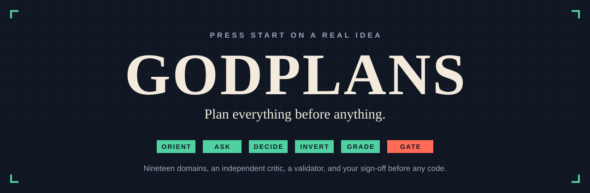
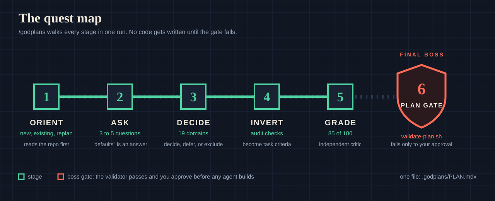

<p align="center">
  
</p>

[](https://www.npmjs.com/package/@hxp-tools/godplans)
[](https://github.com/hannsxpeter/godplans/actions/workflows/lint.yml)
[](CHANGELOG.md)
[](LICENSE)

godplans turns the start of a software project into a quest with rules. The
model does the planning. godplans adds what a model will not do on its own: ask
only the questions that are expensive to get wrong, force a decision in all
nineteen planning domains, turn the checks an auditor would run at the end into
acceptance criteria at the start, grade the draft with an independent critic,
and lock the result behind a validator and your sign-off. Nothing gets built
from a plan you have not approved.

It is one skill and one command. The output is one file,
`.godplans/PLAN.mdx`, that any coding agent executes checkbox by checkbox.

## Press start

```bash
npx @hxp-tools/godplans
```

That installs the skill for every coding tool it finds. Use `--project` to
install into the current project instead of your home directory,
`--tools claude,codex` to pick hosts, and `--uninstall` to remove exactly what
it installed.

Then, in any project folder, describe what you want to build:

```text
/godplans I want to build a shared expense tracker for roommates
```

In Codex the command is `$godplans`; in Windsurf it is `@godplans`.

Claude Code can also install it as a plugin (the command is namespaced, for
example `/godplans:godplans`):

```text
/plugin marketplace add hannsxpeter/godplans
/plugin install godplans@godplans
```

Pick one install method per host. `npx skills add hannsxpeter/godplans` and a
git clone with `sh install.sh` still work.

## The quest map

<p align="center">
  
</p>

| Stage | What happens |
| --- | --- |
| Orient | Greenfield, brownfield, or replan. In an existing repo it reads the stack, structure, and style first, and the plan cites real files. |
| Ask | One batch of three to five questions, only about decisions that are painful to reverse. Each ships with a recommended answer, so `defaults` is a complete reply. |
| Decide | Every one of the nineteen domains is planned now, deferred behind a named trigger, or excluded with a reason. |
| Invert | Checks an auditor would run after the build become acceptance criteria on specific tasks before it. |
| Grade | An independent critic scores every applicable domain. Anything under 85 out of 100 is revised and rescored. |
| Gate | The validator has to pass and you have to approve. Until then, agents refuse to build. |

Before any of it, the idea is screened against the
[Anthropic Usage Policy](https://www.anthropic.com/legal/aup). Prohibited
purposes are refused by name, and legitimate projects with risky parts get
mandatory guardrail tasks.

## Three ways in

| Mode | When | What you get |
| --- | --- | --- |
| Greenfield | A brand new idea | The full plan from one sentence |
| Brownfield | An existing codebase | A plan that extends what is there and cites real files |
| Replan | Reality moved | Completed work kept, new work under new IDs, dead tasks struck through with the reason |

There are no sub-commands. The mode comes from what is on disk.

## Achievements

An achievement is a state your plan reaches, earned in order. None of them can
be claimed by editing a checkbox.

<p align="center">
  
  
  
  
</p>

| Achievement | Earned by |
| --- | --- |
| Graded | The critic scores every applicable domain 85 or higher and prints the scorecard |
| Validated | `validate-plan.sh` passes on the plan as written |
| Approved | You set `status: approved` after reading the plan |
| Done | The mandatory final verification phase passes |

Validated and Done are backed by executed commands. Graded is the critic's
scorecard, and Approved is your decision; see [Limits](#limits).

## The final boss: the plan gate

The plan has a lifecycle, and the validator enforces it:
`planning -> approved -> executing -> done`.

| Status | What it allows |
| --- | --- |
| `planning` | Drafting and review. Agents refuse to build. |
| `approved` | You signed off. The first task moves it to `executing`. |
| `executing` | Agents clear tasks; each one proves itself with its own verify command. |
| `done` | Only a passing final verification phase sets it. Nothing marks itself complete. |

```bash
# check a draft before you approve it
bash .godplans/validate-plan.sh --allow-planning .godplans/PLAN.mdx

# the execution gate, after approval
bash .godplans/validate-plan.sh .godplans/PLAN.mdx

# reprove a finished phase before the next one starts
bash .godplans/validate-plan.sh --drift-check 1 .godplans/PLAN.mdx
```

The drift check reruns a sample of completed verify commands and the phase
checkpoint. Any failure sends the plan back to `planning`.

## Your save file

Everything lives in `.godplans/`, which you commit with your code:

- `PLAN.mdx`: the plan. Objective and non-goals, decisions with the
  alternatives that were rejected, numbered requirements, architecture
  diagrams, phases of checkbox tasks, and exactly one Open Questions section.
- `PLAN.json`: a typed sidecar generated from the MDX, for tools that should
  not parse markdown.
- `validate-plan.sh`: a self-contained copy of the validator, so the agent
  that builds the plan does not need godplans installed.

Every task names its files, dependencies, acceptance criteria, one verify
command, and the requirements it serves:

```markdown
- [ ] GP-203 [W2.1] Add workspace scoping to the expenses table
  - Files: db/migrations/003_expenses_workspace.sql, src/db/expenses.ts
  - Depends on: GP-104
  - Reuses: the workspace helper already in src/db/tenancy.ts
  - Acceptance: every expenses query filters on workspace_id
  - Verify: `npm run test:tenancy`
  - Requirements: R-2.3, R-SEC-4
```

Close the laptop mid-build, come back in three weeks, switch tools: work
resumes by reading the file, not the chat.

<details>
<summary>The nineteen domains</summary>

| Domain | Question it settles |
| --- | --- |
| Product | What to build and for whom? |
| Business | Who pays, for what, and how is success measured? |
| Architecture | How do the pieces fit under load? |
| Stack | On what technology? |
| Database | How is data modeled, indexed, and protected? |
| Security | How is it kept from being broken into or abused? |
| AI integration | Are model calls safe, costed, and evaluated? |
| UX | Do the real journeys work end to end? |
| UI | Is the interface accessible and finished? |
| Search visibility | Can search and answer engines find it? |
| Code quality | Is it readable, tested, and safe to change? |
| Style genome | Does new code match the neighborhood? |
| Agent memory | Do the instruction files coding agents read actually load? |
| Repository | Is the project set up for others? |
| Build | Is anything stubbed or faked? |
| Roadmap | Is the sequence coherent and honest? |
| Deploy | Can it ship and roll back? |
| Observe | Would you know when it breaks? |
| Launch | Is it ready for the public? |

A command-line tool excludes search visibility with a reason instead of
getting a hollow section about it.

</details>

## Works with your tools

| Tool | Invoke |
| --- | --- |
| Claude Code, Cursor, VS Code and Copilot, Factory | `/godplans` |
| Codex CLI | `$godplans` |
| Windsurf | `@godplans` |
| Gemini CLI, OpenCode, Amp, Cline, Zed | picked up from the shared skill paths |
| Any chat UI, Aider, T3 Chat | paste [PROMPT.md](PROMPT.md) |

## Limits

- Graded is an attestation: the critic's scorecard is printed in chat, and the
  validator does not re-run it. Validated and Done are backed by executed
  commands.
- "Audit-aware" means fewer preventable findings, not audit-clean. Planning
  cannot prove runtime behavior and does not replace tests, a security review,
  or an independent audit.
- godplans plans. It does not build. Any coding agent executes the plan.
- Planning this thoroughly costs tokens; see the numbers below.

## Honest status

One published head-to-head, on godplans 1.9.0 with gpt-5.6-sol on the Codex
CLI (2026-07-23). The same builder built the same multi-tenant notes API twice,
once from a godplans plan and once from the plain request. Both passed the same
functional tests. A blind auditor then scored both repositories:

| | Critical findings | High findings |
| --- | --- | --- |
| Built from a godplans plan | 0 | 1 |
| Built without one | 1 | 4 |

Planning used 11,236,025 cumulative tokens against 162,816 for the control.
That is one case on one model, and no later version has been re-measured. The
[method, limits, and raw artifacts](evals/outcomes/results/2026-07-23-tenant-notes-api-codex/README.md)
are published in full. If you run the harness, share the numbers, especially
the ones that make godplans look bad.

## The family

godplans is part of [`@hxp-tools`](https://www.npmjs.com/org/hxp-tools):

- [godpowers](https://github.com/hannsxpeter/godpowers): project memory on disk
  and no "done" without evidence. Executes plans.
- [goddesign](https://github.com/hannsxpeter/goddesigns): draw one card, lock
  it, clear the gate. Designs pages.
- [godaudits](https://github.com/hannsxpeter/godaudits): evidence-first audits
  after the build. Plan requirement `R-SEC-3` pairs with audit check `A-SEC-3`.

## More

- [Architecture](docs/ARCHITECTURE.md)
- [Releasing](docs/RELEASING.md)
- [Maintaining](MAINTAINING.md)
- [Contributing](CONTRIBUTING.md)
- [Security](SECURITY.md)
- [Changelog](CHANGELOG.md)

MIT licensed.
