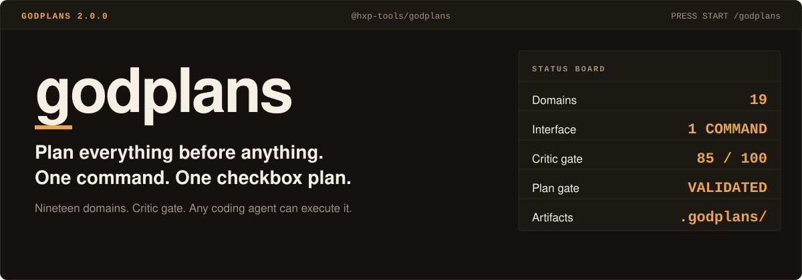
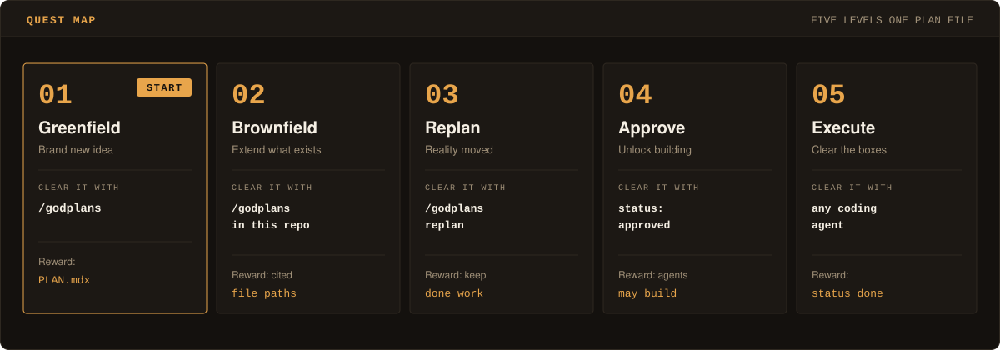
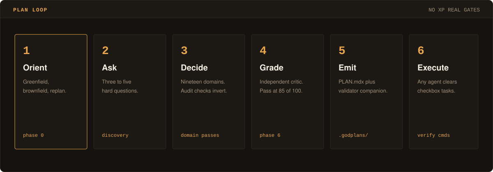

<p align="center">
  
</p>

<p align="center">
  <a href="https://github.com/hannsxpeter/godplans/actions/workflows/lint.yml"></a>
  <a href="https://www.npmjs.com/package/@hxp-tools/godplans"></a>
  <a href="CHANGELOG.md"></a>
  <a href="skills/godplans/SKILL.md"></a>
  <a href="LICENSE"></a>
</p>

<h3 align="center">Plan everything before anything.</h3>

<p align="center"><em>You answer a few hard questions. godplans writes the plan. Any coding agent clears the checkboxes.</em></p>

godplans turns an idea or an existing codebase into one audit-aware master plan
(`.godplans/PLAN.mdx`) before application code is written. Nineteen planning
domains force the decisions that are expensive to reverse. Anticipatable audit
checks become task acceptance criteria. A self-contained validator keeps the
plan honest. Sibling of [godpowers](https://github.com/hannsxpeter/godpowers)
and [godaudits](https://github.com/hannsxpeter/godaudits). Part of
[`@hxp-tools`](https://www.npmjs.com/org/hxp-tools).

---

## Press start

```bash
npx @hxp-tools/godplans@latest
# or install the skill into your harnesses:
npx skills add hannsxpeter/godplans
# or from source:
git clone https://github.com/hannsxpeter/godplans
cd godplans && sh install.sh
```

Then, inside your agent, clear the first level:

| Host | First run |
|---|---|
| Claude Code, Cursor, VS Code, Factory | `/godplans I want to build ...` |
| Codex | `$godplans` |
| Windsurf | `@godplans` |

Everything lands in `.godplans/`. Planning is read-only against your app code.

### Claude Code plugin (alternative)

```text
/plugin marketplace add hannsxpeter/godplans
/plugin install godplans@godplans
```

Claude Code prefixes plugin skills, so the command becomes `/godplans:godplans`.

---

## The quest map

One command. Five levels. Each writes or unlocks artifacts under `.godplans/`.

<p align="center">
  
</p>

| Level | Clear it with | Reward |
|---|---|---|
| 1. Greenfield | `/godplans` on a new idea | `PLAN.mdx` |
| 2. Brownfield | `/godplans` in an existing repo | cited real file paths |
| 3. Replan | `/godplans` when reality moved | completed work kept |
| 4. Approve | set `status: approved` | agents may build |
| 5. Execute | any coding agent | checkboxes clear to `done` |

The game layer is a map, not a scoreboard. There are no points or XP. The real
gates are the critic scores (85 of 100 per domain) and the machine-checked
validator.

<details>
<summary>What the 19 domains cover</summary>

| Area | Question |
|---|---|
| Product | What to build and for whom? |
| Business | Who pays, for what, and how success is measured? |
| Architecture | How do the pieces fit under load? |
| Stack | On what technology? |
| Database | How is data modeled, indexed, and protected? |
| Security | How is it kept from being broken into or abused? |
| AI integration | Are model calls safe, costed, and evaluated? |
| UX | Do the real journeys work end to end? |
| UI | Is the interface accessible and finished? |
| Search visibility | Can search and answer engines find it? |
| Code quality | Is it readable, tested, and safe to change? |
| Style genome | Does new code match the neighborhood? |
| Agent memory | Do AI instruction files actually load? |
| Repository | Is the project set up for others? |
| Build | Is anything stubbed or faked? |
| Roadmap | Is the sequence coherent and honest? |
| Deploy | Can it ship and roll back? |
| Observe | Would you know when it breaks? |
| Launch | Is it ready for the public? |

A domain that does not apply yet is deferred behind a trigger or excluded with
a reason. A command-line tool does not get a hollow search-visibility section.

</details>

---

## Plan loop

<p align="center">
  
</p>

**What you get**

| File | What it is |
|---|---|
| `PLAN.mdx` | Readable master plan with checkbox tasks |
| `PLAN.json` | Typed sidecar for tools that should not parse MDX |
| `validate-plan.sh` | Self-contained companion that proves the plan contract |

A task looks like this:

```markdown
- [ ] GP-203 [W2.1] Add workspace scoping to the expenses table
  - Files: db/migrations/003_expenses_workspace.sql, src/db/expenses.ts
  - Depends on: GP-104
  - Acceptance: every expenses query filters on workspace_id
  - Verify: `npm run test:tenancy`
  - Requirements: R-2.3, R-SEC-4
```

Lifecycle: `planning -> approved -> executing -> done`. Agents refuse to build
from an unapproved plan. Only a passing final verification phase can mark it
`done`.

```bash
bash .godplans/validate-plan.sh --allow-planning .godplans/PLAN.mdx
bash .godplans/validate-plan.sh .godplans/PLAN.mdx
bash .godplans/validate-plan.sh --drift-check 1 .godplans/PLAN.mdx
```

---

## Why plan first

An audit that finds a missing tenant-isolation policy after three weeks has
found a rewrite. A plan that requires that policy before the first migration
has prevented one.

godplans closes the gap between planning tools and after-the-fact auditors by
moving anticipatable checks into the blueprint. Sibling auditors live in
[auditor-suite](https://github.com/hannsxpeter/auditor-suite). Execution and
evidence-backed "done" live in
[godpowers](https://github.com/hannsxpeter/godpowers). End-of-build scoring
lives in [godaudits](https://github.com/hannsxpeter/godaudits).

"Audit-aware" means fewer preventable findings. It does not mean guaranteed
audit-clean, and it does not replace tests or an independent review.

---

## Works with your tools

| Tool | Install path | Invoke |
|---|---|---|
| Claude Code | `~/.claude/skills/godplans` | `/godplans` |
| Codex CLI | `~/.agents/skills/godplans` | `$godplans` |
| Cursor / VS Code / Copilot | `.agents` and `.claude` paths | `/godplans` |
| Windsurf | compat paths; native Windsurf skills | `@godplans` |
| Gemini CLI / OpenCode / Amp | `~/.agents/skills/godplans` | auto |
| Any chat UI | paste [PROMPT.md](PROMPT.md) | manual |

No skill support? Paste [PROMPT.md](PROMPT.md) and attach lazy modules from
`skills/godplans/references/` as needed.

---

## Docs

| Path | Role |
|---|---|
| [`docs/ARCHITECTURE.md`](docs/ARCHITECTURE.md) | Sources, generators, artifacts, checks |
| [`docs/RELEASING.md`](docs/RELEASING.md) | Release checklist |
| [`MAINTAINING.md`](MAINTAINING.md) | Maintainer rituals |
| [`CHANGELOG.md`](CHANGELOG.md) | Release history |
| [`CONTRIBUTING.md`](CONTRIBUTING.md) | Style rules before a PR |

## Development

```bash
npm test
npm run lint
npm run check
```

## License

[MIT](LICENSE).
